  
  
  

---

## About me

I am a software engineer working remotely from Oman as a **DevOps and Backend Engineer at [EasyEnv](https://easyenv.io)**.

EasyEnv is an AI powered engineering hiring platform that runs technical interviews inside **real Linux machines**, not sandboxes. I build and run the production infrastructure behind that: the Kubernetes clusters the platform lives on, the Terraform and Ansible that provision every machine, the mesh VPN that connects them, and the Django services and APIs that tie it all together.

My day tends to sit right on the line between infrastructure and product. One hour it is a cluster that will not schedule, the next it is a REST endpoint or a frontend view.

Away from the terminal I am usually gaming, working through a book, or spending time with my family.

 

## What I do at EasyEnv

| | Area | What that looks like |
|:--:|:--|:--|
| ☸️ | **Kubernetes** | Provision and run clusters on GCP and Hetzner, with deploys driven by GitHub Actions pipelines |
| 🧱 | **Infrastructure as Code** | Automate provisioning with Terraform, and author the Ansible roles that build every workspace machine |
| 🖥️ | **Linux and virtualization** | Production infrastructure for a platform whose product *is* a Linux box: Proxmox, KVM, cloud-init |
| 🔐 | **Networking** | NetBird mesh VPN for secure remote access across distributed infrastructure, with no box exposed to the internet |
| 📈 | **Observability** | Grafana, Telegraf, Prometheus and Loki, so a failing box is visible before a candidate notices it |
| 🤖 | **AI features** | Integrated Claude via the Anthropic Agent SDK for AI assisted interviews and assessment review |
| 🐍 | **Backend and API** | Backend features, REST APIs and frontend views in Python, Django and JavaScript |

 

## Tech I work with

**Languages and Frameworks**

**Cloud, Containers and IaC**

**CI/CD, Data and Observability**

 

**Also in the toolbox**

  
  
  
  
  
  
  
  
  
  

**AI and LLM**

  
  
  
  
  
  
  

 

## GitHub

 

### Say hello

